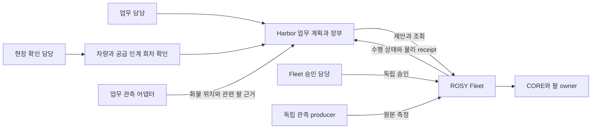

# 역할·책임·업무 흐름 상세설계

상태: 검토안. 용어와 물리 역할은 ADR0005/CONTEXT를 따르고, 아래 사람 역할·웹 권한은 신규 설계다. 현재 Harbor에 이 RBAC가 구현되어 있지 않다.

## 1. 사람의 책임 역할

| 역할 | 주요 판단과 조작 | 하지 않는 것 | 주 화면 |
|---|---|---|---|
| 업무 담당 | 양하/장치·반출 요청 등록, 관측 재고 기준 계획 비교, 업무 우선순위, 제안 전 검토, 보류 사유 대조 | 로봇 궤적 지정, 관측값 수정, Fleet 자동 승인 | PC 업무 목록·계획·작업 상세 |
| 현장 확인 담당 | 대상 차량·공급 인계 회차를 확인하고 S가 적재면을 비웠는지 직접 확인, 불일치/확인 불가 신고 | A/B의 안전·퇴피를 수동 참으로 만들기, 원격 이송 강제 출발 | 태블릿 확인 목록·상세 |
| Fleet 승인·운영 담당 | 현재 제안/자원/조건을 Fleet에서 확인·승인, 실행 상태·정지·복구 판단 | Harbor의 업무 근거 없이 업무 완료 판정 | Fleet 승인·운영 화면 + Harbor 작업 참조 |
| 설치·운영 관리 담당 | 검증된 binding·관측 source·신선도·장비 대응·권한 정책의 등록/검토 | 진행 중 작업의 기준 덮어쓰기, DB/claim 삭제로 보류 해제 | PC 설정·연결 상태·감사 |

겸임은 가능 여부를 별도 결정한다. 관리 역할을 가진 사람이 자동으로 실행 승인권을 갖지는 않는다. 실제 계정·권한 발급은 인증 설계와 현장 운영 정책이 정해져야 한다.

**승인 주체 주의:** 현재 ARM 계약은 proposal principal과 승인 principal이 다른지 검사한다. Harbor 서비스 principal 뒤의 사람과 Fleet 사람이 같은지까지 증명하지 않는다. UI에 “서로 다른 두 사람이 검증함”을 표시하려면 사람 신원 대응과 감사 계약이 추가로 필요하다.

## 2. 장치와 소프트웨어의 역할

| 주체 | 소유하는 것 | Harbor에 필요한 정보 |
|---|---|---|
| 공급암 S 운영자/외부 시스템 | S 조작·감독, 컨베이어 적재 점유 규칙 | 적재 도착 관측과 해당 차량 적재면 퇴피 확인 |
| 적층암 A·B owner | 궤적·그리퍼·최종 명령 허가·정지, 측정 자세 | 현재 attempt의 수행·물리 상태와 신뢰 가능한 근거 |
| Pinky/CORE | 실제 주행·안전·정지 | 배정된 차량·이송 attempt·도착 사실 |
| 컨베이어 | 한 방향 상시 동작, 용량1 구간 | 점유/도착 관측. Harbor에 기동·역회전 버튼을 만들지 않음 |
| Harbor domain·업무 장부 | 재고 의미, 계획 revision, 순서·binding·업무 완료 | Fleet 결과와 업무 관측을 대조해 현재 단계만 진행 |
| ROSY Fleet | 접수·승인·claim·Action/attempt·monitor·receipt | 공개 HTTP로 현재 사실과 거절 이유 반환 |
| World/독립 관측 producer | 원본 시각·source·좌표계·보정·대상에 결속된 관측 | 설치된 인증 경로를 통해 전달. 앱이 기대값으로 합성하지 않음 |

새 웹 계층과 업무 관측 어댑터는 설계 대상이다. 그림을 현재 운영 시스템의 배포도로 읽지 않는다.

## 3. 권한 동작표 초안

`○`는 그 책임의 후보 권한이다. 실제 역할/자원/업무별 검사와 서버 구현 전에는 허가된 버튼으로 개방하지 않는다.

| 동작 | 업무 | 현장 확인 | Fleet 운영 | 설치·운영 관리 | 검사 위치 |
|---|---|---|---|---|---|
| 허용된 업무·재고·근거 읽기 | ○ | 배정 범위 | ○ | ○ | Harbor 서버: 사용자·업무 범위 |
| 계획 작성·검토·제안 | ○ | — | 별도 권한 | — | Harbor 서버 + Fleet 제안 권한 |
| S 퇴피 확인 제출 | 별도 현장 권한 | ○ | 별도 현장 권한 | — | Harbor 확인 경계: 신원·대상·회차·원본 시각 |
| ARM 승인 | — | — | ○ | — | Fleet의 현재 named operator 세션 |
| ARM 취소 요청 | 업무 범위에 별도 권한 | — | ○ | — | 계약 권한·원래 job scope. 취소 ACK는 정지 아님 |
| E-stop/재무장/로봇 복구 | — | 현장 물리 급정지 수단 | ○ | 별도 Fleet 권한 | Fleet/CORE/owner. Harbor가 대행하지 않음 |
| 수동 후보 제외 상태 수정 | ○ | 신고만 | ○ | ○ | Harbor 감사. 실제 가용성과 분리 |
| binding/source/기준 변경 | — | — | 검토 협의 | ○ | 설정 버전·검증 기록·진행 작업 보호 |
| 완료 근거 강제 생성·claim 강제 해제 | — | — | — | — | 제공하지 않음 |

## 4. 흐름 A — 양하 이후 장치

이 전체 공정의 웹 구현은 신규다. 현재 `plan_outbound`가 양하 계획까지 구현한다고 가정하지 않는다.

| 단계 | 사용자 경험 | 시스템의 진행 조건 | 미충족 때 |
|---|---|---|---|
| A1 업무 접수 | 화물 ID·업무 출발/목적·기준 관측 확인 | 설치된 화물/위치 대응과 원본 revision | 미등록/불명은 요청 초안 유지 |
| A2 본선→공급 작업대 이송 | 후보 제외 이유와 배정·이송 단계를 표시 | Fleet의 현재 TRIP 권한/조건. 차량 도착과 실제 화물 동승 관측은 별개 | 실제 화물/차량 대응 불명 시 공급 인계 보류 |
| A3 Pinky→S→컨베이어 인계 | S가 온 화물을 집어 컨베이어에 싣는 외부 단계 | 차량·화물·현재 공급 인계 회차 대응과 컨베이어 점유 조건 | Harbor는 S를 명령하지 않으며 불명 사실을 완료로 만들지 않음 |
| A4 S의 차량 적재면 퇴피 확인 | 현장 확인자가 그 차량의 적재면을 직접 확인 | 현재 회차·허용된 확인자·신선도·미소비 | 단순 체크박스·과거 사진으로 허가하지 않음 |
| A5 공급 작업대에서 Pinky 출발 | 회차에 결속된 별도 출발 요청 | Fleet의 현재 TRIP 권한/조건 + S 퇴피 업무 조건 | 승인/위임·회차 결속이 없으면 출발 조작 불가 |
| A6 컨베이어→적층 측 도착 | 점유와 화물 ID·도착을 관측 | 인증된 화물/컨베이어 근거 | 차량이 떠났다는 사실로 컨베이어 도착을 추정하지 않음 |
| A7 A/B 장치 제안 | 가능한 팔·목적 칸과 검토된 기준을 표시 | 신선한 물리 사전검사·binding + 별도 승인 | 도달/기준 불명은 제안 보류 |
| A8 장치 대조 | 수행과 내려놓기·퇴피 근거를 따로 읽음 | 단계별 현재 identity와 독립 근거 | Action 성공만 있으면 “근거 대기” |

S 퇴피는 A/B의 전체 반출 완료 조건과 합치지 않는다. 컨베이어에 화물이 있다는 관측만으로 어떤 화물이 어느 차량에서 왔는지 정하지 않는다.

이번 설계의 **공급 인계 회차**는 특정 차량·화물이 공급 작업대에 도착해 S의 화물 하차, 차량 적재면 퇴피 확인, 그 차량의 출발 의도를 대조하는 한 묶음이다. 신규 데이터 개념이며 아직 저장 모델이 없다. S 퇴피 확인은 이 공급 작업대 출발에 적용하며, 본선에서 공급 작업대로 오는 첫 이송이나 모든 TRIP에 일괄 적용하지 않는다. A5와 A6은 각각의 근거가 갖춰지면 독립적으로 진행할 수 있다.

## 5. 흐름 B — 재취급을 동반한 반출

예: 장치 칸의 아래 화물 C1을 꺼내기 위해 위의 C2를 옮긴다. ID는 합성 예다.

1. 업무 담당이 C1을 선택한다. 현재 관측 revision과 C2의 위치·시각을 함께 확인한다.
2. Harbor가 C2→허용 임시 위치, C1→반출대, C2→유효 장치 위치 복귀를 제안한다. 각 이동의 주 팔/대체 팔과 그 판단 기준을 표시한다.
3. 임시 위치가 없거나 관측/도달 정보가 부족하면 실행 가능한 일부만 잘라 보내지 않고 계획 전체를 보류한다.
4. 검토한 계획을 장부에 고정한다. 새 관측 revision이 오면 기존 계획을 조용히 바꾸지 않고 재검토 대상으로 표시한다.
5. 현재 단계의 ARM만 제안한다. 사람이 Fleet에서 승인한다. 이후 실행 추적은 Fleet이 담당한다.
6. Harbor가 현재 mission/attempt와 physical receipt를 대조한다. 배치·복귀·관련 팔 퇴피 근거를 업무 기준과 대조해야 다음 단계로 간다.
7. 마지막 단계 이후에도 반출 완료3요소를 별도로 대조한다. 모두 확인되어야 `finish`로 완료한다.

현재 API v1.312의 검증된 설치는 단일 physical profile/이동이다. 위 다단계 전체를 한 화면의 “모두 실행”으로 개방할 수 있다는 뜻이 아니다. 다중 binding·순차 실행·관련 팔 근거의 운영 결속은 구현 단계의 선행 조건이다.

## 6. 상태와 화면 표현

| 실제 업무 장부 상태 | 권장 문구 | 가능한 조작 |
|---|---|---|
| `PLANNED` | 계획 준비 / 제안 전 | 현재 revision·권한·binding 대조 후 현재 단계 제안 |
| `SUBMITTING` | 접수 결과 확인 중 | 중복 전송 금지, 대조 진행 |
| `WAITING` | 실행 승인/수행/근거 대기 | Fleet 상태·근거를 각각 조회. `WAITING`만으로 하위 이유 추정 금지 |
| `HOLD` | 보류 — 대조 필요 | 원래 key/mission/attempt 확인. 상태 초기화·자동 재제안 금지 |
| `AWAITING_FINAL_EVIDENCE` | 최종 업무 근거 대기 | 반출 완료3요소 대조 |
| `COMPLETED` | 업무 완료 | 기록 읽기. 새 요청은 별도 업무 identity |

“승인 대기”, “근거 부족” 등의 세부 표시는 read model의 표현이다. 기존 persisted enum에 같은 이름의 상태가 있다고 구현하지 않는다. 앱 업무 상태, Fleet job, native Action, 관측의 신선도를 별도 축으로 보존한다.

## 7. 보류를 다루는 원칙

연결 복구·재로그인·새로고침·뒤로가기는 POST 재시도가 아니다. 원래 key와 현재 snapshot을 읽고 결과를 대조한다. 안전상 불명인 실행을 “실패했으니 다시 실행”으로 안내하지 않는다. 수동 재고 정정은 별도 검증·감사 절차를 설계해야 하며, 근거 없는 완료나 이전 장부 덮어쓰기로 사용하지 않는다.
